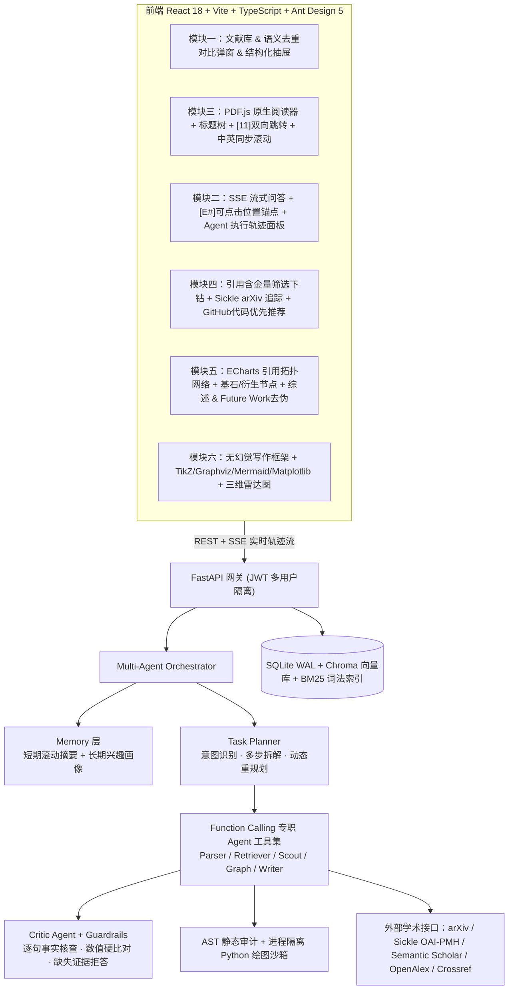

# ScholarAgent · 智研助手

> **智领科研 · 意图驱动：基于大模型与 Multi-Agent 架构的全流程科研助手应用系统**  
> 传智杯全国高校 AI 大模型创新应用挑战赛参赛作品

---

## 一、项目简介

**ScholarAgent（智研助手）** 面向前沿学术研究与论文写作场景，从 0 到 1 构建了一套涵盖 **文献细粒度多模态解析、内容语义级去重、抗幻觉溯源问答、版式感知双向阅读翻译、Sickle 动态追踪与个性化推荐、局域引用拓扑图谱与综述挖掘、无幻觉写作与数据可视化 Copilot** 的全栈科研助手 Agent 系统。

系统彻底摒弃简单的单次 API 黑盒调用，显式设计并实现了 **Task Planning（任务规划）、Memory（短期会话与长期画像记忆）、Function Calling（工具注册与调度）、Multi-Agent 协同（Planner / Parser / Retriever / Scout / Graph / Writer / Critic）** 以及 **Source Tracing（源头位置锚点溯源）+ Guardrails（输入与输出双重安全防护）**。

---

## 二、系统架构



---

## 三、六大命题模块与验证用例全覆盖对照表

| 命题模块 / 赛题要求 | 实现方式与核心特性 | 对应代码模块 |
|---|---|---|
| **模块一：PDF 管理与细粒度解析** | 单篇/批量上传、CRUD；**MinHash 5-gram + Embedding 余弦语义去重**（不依赖文件名，自动识别 v1/v7 版本新旧并给出保留/覆盖建议，LLM 自动总结两版修订差异）；区分矢量 PDF、无文本层**扫描件 OCR**（并发视觉模型还原公式/表格）、**541 页超长教材**（分批流式解析 + 显式 GC 内存控制）；结构化抽取标题、作者与机构、摘要、1–3 级标题树、表格、图片、LaTeX 公式、参考文献与附录 | `backend/app/dedup/`<br/>`backend/app/parsing/`<br/>`LibraryView.tsx` |
| **模块二：抗幻觉知识问答 (RAG & 多文推理)** | 章节与块结构感知切块（表格/公式保持完整）；**BM25 词法 + Chroma 稠密向量 + RRF 倒数秩融合 + 多文均衡召回**；回答强制携带 `[E#]` 原文锚点（含 `paper_id, page, bbox`），点击直接跳页高亮；**Critic Agent** 逐句可信度校验 + 数值硬核对 + 无证据强制拒答；支持 BERT vs Transformer、GPT-1/2/3 参数量、Post-LN vs Pre-LN、Context Window 跨文献联合推理 | `backend/app/rag/`<br/>`backend/app/agents/`<br/>`AgentChatView.tsx` |
| **模块三：版式感知阅读与双向联动翻译** | 原生集成 **PDF.js** 渲染单双栏/公式/表格；左侧 1–3 级标题树点击跳页；正文引用标记 `[11]` ↔ References 条目**双向无损跳转**；支持划词/悬停翻译、整篇翻译（**代码与 LaTeX 公式保留英文**）、Markdown/HTML 导出，以及左右双栏**自动同步滚动**对比阅读 | `backend/app/api/reader.py`<br/>`ReaderView.tsx` |
| **模块四：论文自动检索、追踪与智能推荐** | 输入论文名或从参考文献一键下钻抓取入库；独创**「引用含金量」评分模型**（融合正文引用语境实质性判定、引用频次、顶会权重与被引数），**自动剔除应付式背景罗列引用**；集成 **Sickle (OAI-PMH)** 定期追踪 arXiv，结合本地文献库向量相关性、**开源 GitHub 代码易复现加权**、点赞/踩实时画像更新与**多用户协同过滤**生成推荐 | `backend/app/scout/`<br/>`ScoutView.tsx` |
| **模块五：局域引用图谱与学术综述** | 批量文献自动匹配 DOI / arXiv ID / 模糊标题构建有向引用图；运用 **NetworkX PageRank、入度/出度、介数中心性、贪心模块度社区发现** 挖掘「**基石论文**」「桥梁枢纽」与「**边缘衍生论文**」；前端 **ECharts** 力导向交互渲染；基于图谱生成带 `[P#]` 出处的领域综述；提取多篇 Future Work 结合时间线与最新进展**自动排除已被解决的旧 idea** | `backend/app/graph/`<br/>`GraphView.tsx` |
| **模块六：学术写作辅助与可视化 Copilot** | 输入 Idea 自动生成 Abstract / Introduction / Related Work / Method 框架，所有 References 经 **Crossref + Semantic Scholar + arXiv 实名校验确保 100% 真实无幻觉**；生成 **Mermaid / TikZ / Graphviz / Matplotlib** 架构拓扑图脚本并实时预览；上传 CSV 在 **AST 安全沙箱**中生成**学术表格 / 折线图 / 柱状图 / 三维雷达图**并自动提炼中英双语 **Figure Caption**；支持中文摘要/全文一键译为 IEEE/NeurIPS 规范英文 | `backend/app/copilot/`<br/>`CopilotView.tsx` |

---

## 四、测试数据集与官方验证用例说明

系统预置并通过了赛题第 3 节规定的全部验证用例：
1. **3.1 内容去重与版本演进 (`1706.03762v7.pdf` vs `1706.03762v1.pdf`)**：库中预置最新版 `v7`；在界面上传 `data/official_pdf/1706.03762v1.pdf`（即使改名上传），系统基于正文语义检出高度重合（语义相似度 >95%），主动弹窗提示「库中已有更新版本 v7（2 Aug 2023），建议保留现有版本」，并自动列出两版修订差异（如英法 BLEU 由 41.0 修订为 41.8、新增 Google 版权归属声明与作者贡献脚注等）。
2. **3.2 多模态与长文档解析**：
   - 标准矢量双栏 PDF：`1706.03762v1.pdf` / `v7.pdf`（精细提取标题、8 位作者与 3 所机构、22 个 1–3 级章节、4 张表格、架构图、LaTeX 公式、40 条参考文献与视觉附录）。
   - 图像扫描版 PDF：`1706.03762v1_img.pdf`（无原生文本层，自动切换视觉多模态 OCR 并发识别，完整还原标题、双栏正文、公式与结构）。
   - 超长篇幅书籍：`UnderstandingDeepLearning_02_09_26_C.pdf`（共 **541 页**，分批流式解析 + 181 节目录树 + 内存平稳控制，约 55 秒完成全书切块与向量索引构建）。
3. **3.3 多领域多排版风格泛化 (`data/official_pdf/real_corpus/`)**：全部采用 arXiv 与 OpenAI 官方公开发布的真实论文 PDF，包含 **BERT**（`1810.04805`）、**GPT-1 / GPT-2 / GPT-3**（`2005.14165`）、**Pre-LN**（`2002.04745`），以及 **IEEE TPAMI（SegNet）**、**ACM KDD（XGBoost）**、**Springer LNCS / MICCAI（U-Net）**、**Nature 收录论文 Pangu-Weather（预印本）** 四类国际期刊与顶会排版风格，全面支撑跨文献联合推理与真实引用图谱构建。

---

## 五、快速安装与运行指南

### 1. 环境要求
- Python 3.11 或 3.12
- Node.js >= 18

### 2. 配置环境变量
复制根目录下的 `.env.example` 为 `.env`，填入阿里云百炼（DashScope）API Key：
```bash
cp .env.example .env
# 编辑 .env，设置 DASHSCOPE_API_KEY=sk-xxxx
```
> 安全说明：`.env` 已列入 `.gitignore`，所有敏感密钥仅通过环境变量注入，绝不进入代码仓库。

### 3. 安装依赖与预置演示数据
```bash
# 1) 创建 Python 虚拟环境并安装后端依赖
python -m venv .venv
# Windows:
.\.venv\Scripts\pip install -r backend/requirements.txt
# Linux / macOS:
# .venv/bin/pip install -r backend/requirements.txt

# 2) 安装前端依赖
cd frontend && npm install && cd ..

# 3) （可选）一键预置官方测试集、多风格论文、引用图谱与推荐流
.\.venv\Scripts\python scripts/seed_demo.py
```

### 4. 启动服务
- **Windows 一键启动**：双击或运行 `scripts\start_dev.bat`，自动启动后端 (`http://localhost:8000`) 与前端 (`http://localhost:5173`)。
- **手动启动**：
  ```bash
  # 终端 1：启动 FastAPI 后端
  cd backend
  ..\.venv\Scripts\python -m uvicorn app.main:app --host 0.0.0.0 --port 8000 --reload

  # 终端 2：启动 React 前端
  cd frontend
  npm run dev
  ```
- **运行自动化测试与问答评测集**：
  ```bash
  cd backend && ..\.venv\Scripts\pytest -v
  ..\.venv\Scripts\python scripts/eval_qa_benchmark.py
  ```

---

## 六、在线演示与评审专用测试账号

- **评审专用测试账号**（首次启动自动初始化，免注册直接登录）：
  - 用户名：`reviewer`
  - 密码：`Scholar-Review-2026`（生产环境可通过 `.env` 中 `REVIEWER_PASSWORD` 配置）
- **Linux 云服务器一键部署**：提供 `deploy/deploy.sh`、`deploy/nginx.conf` 与 `deploy/scholar-agent.service`，在 Ubuntu 22.04+ 服务器上执行 `sudo bash deploy/deploy.sh` 即可完成 Nginx 反代与 systemd 常驻守护。

---

## 七、团队与作者信息

| 项目 | 信息 |
|---|---|
| 参赛者 | **李嘉成**（个人赛，独立完成全部架构设计、前后端开发、算法调优与文档编写） |
| 所属院校 | **重庆科技大学** |
| 代码仓库 | https://github.com/liuchengfeng116-dev/scholar-agent |
