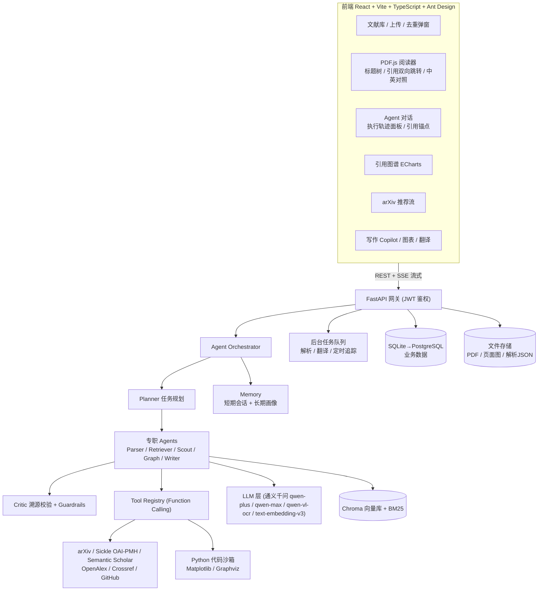

# ScholarAgent · 智研助手 —— 系统架构设计

> 全栈科研助手 Agent：文献导入 → 去重解析 → 版式阅读/翻译 → 抗幻觉问答 → 检索追踪推荐 → 引用图谱综述 → 写作辅助。

## 1. 总体架构



## 2. 目录结构

```
scholar-agent/
├── backend/
│   ├── app/
│   │   ├── main.py              # FastAPI 入口
│   │   ├── core/                # 配置、安全、日志
│   │   ├── db/                  # SQLAlchemy 模型与会话
│   │   ├── api/                 # 路由：auth, papers, qa, reader, scout, graph, copilot
│   │   ├── llm/                 # LLM/Embedding/VLM 客户端抽象
│   │   ├── agents/              # planner, orchestrator, memory, critic, guardrails, 各专职 agent
│   │   ├── tools/               # Function Calling 工具注册与实现
│   │   ├── parsing/             # PDF 矢量解析、OCR、公式、表格、参考文献、长文档
│   │   ├── dedup/               # MinHash + Embedding 语义去重、版本识别、差异总结
│   │   ├── rag/                 # 分块、索引、混合检索、重排、引用组装
│   │   ├── scout/               # 下钻下载、引用含金量、arXiv 追踪、推荐
│   │   ├── graph/               # 引用网络、图算法、综述、Future Work
│   │   ├── copilot/             # 论文框架、文献校验、绘图脚本、CSV 图表、翻译
│   │   └── tasks/               # 后台任务与定时任务
│   ├── tests/
│   └── requirements.txt
├── frontend/                    # React 应用
├── data/                        # 运行期数据（不入库）
├── docs/                        # 设计文档、技术文档、视频脚本
├── scripts/                     # 部署、评测、数据预置脚本
├── .env.example
└── README.md
```

## 3. 核心数据模型

| 表 | 关键字段 |
|---|---|
| users | id, username, password_hash, role, interests(JSON) |
| papers | id, owner_id, title, authors(JSON), affiliations(JSON), abstract, arxiv_id, version, year, venue, doi, file_path, file_hash, page_count, has_text_layer, status(uploaded/parsing/ready/failed), progress, github_url, created_at |
| paper_versions_link | paper_id, duplicate_of, similarity, decision(keep/overwrite), diff_summary |
| sections | id, paper_id, level(1/2/3), title, page, bbox, parent_id, order |
| blocks | id, paper_id, section_id, type(text/table/figure/formula/caption/reference/appendix), page, bbox(JSON), content, latex, html, image_path |
| references | id, paper_id, idx, raw_text, title, authors, year, doi, arxiv_id, matched_paper_id, cite_contexts(JSON), quality_score |
| chunks | id, paper_id, block_ids, section_path, page, bbox, text, (向量存 Chroma) |
| translations | paper_id, block_id, lang, text |
| conversations / messages | id, user_id, role, content, citations(JSON), trace(JSON) |
| memories | user_id, kind(preference/fact/topic), content, embedding_id, updated_at |
| recommendations | user_id, arxiv_id, score, reason, has_code, feedback(+1/-1/0) |
| tasks | id, type, status, progress, payload, result, error |

## 4. Agent 协作协议

1. **Planner**：根据用户意图 + Memory 生成 JSON 计划 `[{step, agent, tool, args, depends_on}]`，可动态重规划。
2. **Orchestrator**：按依赖拓扑执行步骤，Function Calling 调工具，结果写入共享 Scratchpad；全过程以 SSE 推送 `plan / tool_call / tool_result / thought / answer / citation` 事件给前端执行轨迹面板。
3. **Critic**：对最终回答逐句抽取论断 → 匹配证据块 → 支持度判定；不支持的句子标记或删除，证据为空则拒答（Guardrails）。
4. **Memory**：短期 = 最近 N 轮对话摘要；长期 = 用户研究方向、偏好（由点赞/踩、提问自动沉淀），检索注入 Planner。

## 5. 抗幻觉设计（Source Tracing）

- 所有可显示的事实都携带 `(paper_id, page, bbox, block_id)` 锚点，前端点击即跳转高亮。
- 数值型问题（β、BLEU、GPU 数量）优先从表格/正文原文抽取并原文比对。
- 生成的 References 必须经 Crossref / Semantic Scholar / arXiv 至少一个来源命中才保留。
- 综述/Future Work 每个论断附引用；“已解决”判定附反证论文。

## 6. 关键 API（REST，前缀 /api）

| 模块 | 路由 |
|---|---|
| 认证 | POST /auth/login, POST /auth/register, GET /auth/me |
| 文献 | POST /papers/upload（批量）, GET /papers, GET/PATCH/DELETE /papers/{id}, POST /papers/{id}/dedup-decision, GET /papers/{id}/structure, GET /papers/{id}/file |
| 问答 | POST /chat (SSE), GET /conversations |
| 阅读 | GET /papers/{id}/citations-map, POST /translate/snippet, POST /papers/{id}/translate, GET /papers/{id}/translation |
| 检索推荐 | POST /scout/fetch, POST /scout/fetch-references, GET /recommend, POST /recommend/{id}/feedback, POST /scout/track |
| 图谱 | POST /graph/build, GET /graph/{id}, POST /graph/{id}/survey, POST /graph/{id}/future-work |
| Copilot | POST /copilot/outline, POST /copilot/diagram, POST /copilot/chart (CSV), POST /copilot/translate |
| 任务 | GET /tasks/{id} |
