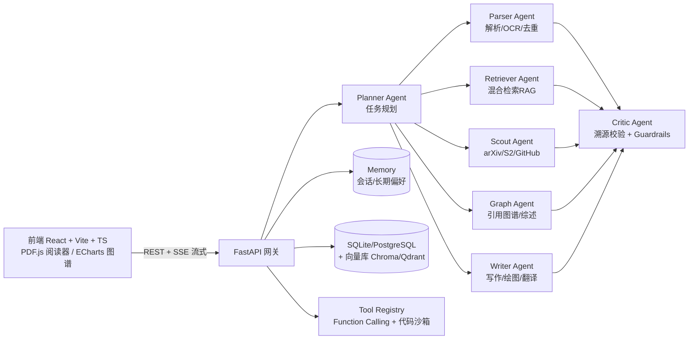

# 传智杯 · AI大模型创新应用挑战赛 —— 「科研助手 Agent」完整制作流程

> 赛题：**智领科研·意图驱动：基于大模型与 Agent 架构的全流程科研助手构建挑战赛**
> 目标：从 0 到 1 构建一个**全栈**、具备**自主规划与协同能力**的科研助手 Agent，覆盖 6 大功能模块，并交付 **代码仓库 + 演示视频 + 技术文档PDF + 在线演示地址** 四类材料。

图例：🤖 = 我（AI）来做　🧑 = 需要你来做　⛔ = **阻塞点，必须等你完成后我才能继续**　✅ = 对应的赛题原文要求

---

## 一、赛题要求逐条清单（防遗漏总表）

### A. 总体硬性要求（命题范围 1）
| 编号 | 要求 | 落实阶段 |
|---|---|---|
| G1 | 输入素材可审查：稳定处理学术标准 PDF 论文、**扫描件 PDF** | 阶段2 |
| G2 | 输出成果可验证：解析结果、问答溯源、图谱节点、代码与绘图脚本、综述文本均具备**确定性、可交互验证、高复现性** | 全阶段 |
| G3 | 系统运行闭环：完整**前后端界面 + Agent 后端服务**，能演示**从文献导入到写作辅助的全流程闭环** | 阶段9 |
| G4 | 后端语言/前端框架不限 | 阶段1 |

### B. 六大功能模块（命题范围 2，须**全面覆盖**）
| 编号 | 模块 / 子功能 | 关键细节（原文） |
|---|---|---|
| M1.1 | 基础 CRUD | 单篇 / 批量 PDF 上传、查看、删除、修改 |
| M1.2 | 语义级去重 | **基于内容**（非文件名）对比 v1 与 v7 正文；预警；用户选择「覆盖/保留」；智能建议保留最新版；高级：自动总结两版主要修订差异 |
| M1.3 | 多模态细粒度解析 | 扫描件 OCR、长篇书籍（541页）；抽取：**标题、作者及机构、摘要、一/二/三级标题树、表格、图表、LaTeX 公式、参考文献、附录**，结构化呈现 |
| M2.1 | 单篇精准问答 | 作者与机构、超参数 β₁/β₂、训练 GPU 型号与数量、特定任务 BLEU 分数比对、指定文献完整引用信息；**必须提供原文出处/位置锚点** |
| M2.2 | 多篇跨文献对比 | BERT vs Transformer Encoder 承袭与抛弃、GPT-1/2/3 参数量演化、LN 位置调整、Context Window 递增 |
| M3.1 | 智能引导与双向跳转 | 原生渲染单双栏/公式/表格；标题树导航；正文引用标记 [11] ↔ References 条目**双向无损跳转** |
| M3.2 | 中英对比与联动滚动 | 局部划词/悬停翻译；整篇翻译（输出 Markdown/HTML 或保持原位排版 PDF，**代码与公式保留英文**）；中英对比阅读，两侧**拖动自动同步滚动** |
| M4.1 | 智能下钻下载 | 给定论文名称或参考文献列表 → 调用搜索引擎/API 自动抓取入库；**「引用含金量」筛选，自动剔除应付式引用** |
| M4.2 | arXiv 动态追踪与个性化推荐 | 用 **Sickle** 等工具定期刷新 arXiv；结合本地文献库计算相关性；**优先推荐附带开源 GitHub 代码**的论文；提供推荐理由；**点赞/踩互动**；多用户推荐算法拓展 |
| M5.1 | 引用拓扑图谱与基石节点 | 批量文献（如20篇）自动解析彼此引用 → 前端可视化图谱 → 图论算法挖掘「**基石论文**」与「**边缘衍生论文**」 |
| M5.2 | 自动综述与前沿探索 | 基于图谱生成领域简短综述；提取多篇 Future Work，结合时间线与最新进展，**自动排除已被解决的旧 idea**，提炼真正有价值的未来方向 |
| M6.1 | 无幻觉框架与拓扑图生成 | idea → Abstract / Introduction / Related Work + **真实无幻觉 References**；生成 **TikZ / Graphviz / Mermaid / Matplotlib** 架构拓扑图脚本 |
| M6.2 | 数据可视化与图注提炼 | 读取用户 CSV → 表格/折线图/柱状图/**三维雷达图**；自动提炼符合学术规范的 **Figure Caption** |
| M6.3 | 学术翻译 | 中文摘要或全文 → 一键精准译为学术规范英文 |

### C. 核心能力考察点（赛项介绍 1-5 + 教育意义）—— 评委会重点看的「AI 亮点」
| 编号 | 考察点 | 我们的体现方式 |
|---|---|---|
| C1 | 多模态与细粒度文档感知 | 版面分析 + OCR + 公式识别 + 语义去重 |
| C2 | 抗幻觉 RAG 与多文推理 | 混合检索 + 重排 + 引用锚点 + 证据校验 |
| C3 | 自主工具调用与闭环探索 | arXiv/Semantic Scholar/搜索引擎/GitHub API、Python 代码执行沙箱 |
| C4 | 图谱拓扑挖掘与学术洞察 | 引用网络 + PageRank/中心性 + Future Work 过滤 |
| C5 | 学术 Copilot 与可视化 | 框架生成 + 绘图脚本 + CSV 图表 + Caption |
| C6 | 底层架构（不能是简单 API 调用） | **Task Planning、Memory、Function Calling、Multi-Agent 协同** 必须显式实现并可展示 |
| C7 | 抗幻觉与学术伦理 | **Source Tracing（溯源）、Guardrails（安全防护）、逻辑验证机制** |

### D. 测试数据集与验证用例（第 3 节）
| 编号 | 用例 | 预期行为 |
|---|---|---|
| T1 | 先传 1706.03762v7.pdf，再传 v1.pdf | 基于语义检出高度重合 → 去重预警 → 覆盖/保留 → 提示「库中已有更新版本，建议保留」→ 自动对比修订差异 |
| T2 | 1706.03762v1.pdf（标准矢量） | 双栏文本、层次标题、嵌入式 LaTeX 公式、表格精细解析 |
| T3 | 1706.03762v1_img.pdf（图像扫描版） | 无原生文本层下的 OCR、图表提取、结构化还原 |
| T4 | UnderstandingDeepLearning_02_09_26_C.pdf（541页） | 百页级长文档解析（⚠️截图此句被截断，需你补充原文） |
| T5 | pdf/ 目录其他预置 PDF | 单篇/多篇 RAG、双向联动阅读、引用图谱、写作辅助 |
| T6 | 自行补充 IEEE / ACM / Springer / Nature 等不同领域/排版论文 | 展示泛化性与实用价值（加分项） |

### E. 提交材料（第 2 节）
| 编号 | 材料 | 要求 |
|---|---|---|
| S1 | 代码托管 | GitHub / Gitee，**Public** 或提供评审访问权限 |
| S2 | 代码规范 | 结构清晰、有效注释、遵循主流规范 |
| S3 | README | **项目介绍、技术架构、安装运行指南、团队信息** |
| S4 | Git 记录 | **保留完整提交历史，体现真实开发过程**（不能一次性提交/压缩历史） |
| S5 | 环境配置 | **环境变量模板 + 依赖清单** |
| S6 | 演示视频 | **5–8 分钟、MP4、≥1080p、普通话讲解（可配字幕）**；含项目介绍、核心功能演示、AI 技术亮点 |
| S7 | 技术文档 | **PDF、≤30 页**；项目概述、需求分析、系统架构设计、AI 技术方案、核心功能实现、测试与部署、总结与展望；**重点写 AI 技术选型理由、集成方式、优化策略**；**明确列出技术创新点与应用创新点** |
| S8 | 在线演示 | **公网可访问地址**；**评审期间保持可用**；需登录则提供**评审专用测试账号** |
| S9 | 注意事项 | 截止前经**大赛官网统一提交**；**API 密钥不得出现在公开仓库**（环境变量配置）；**提交后不得修改**；材料不完整影响评审 |

---

## 二、技术方案（✅ 已确认：通义千问 / 阿里云百炼 · Python FastAPI + React/Vite/TS · GitHub · 新建项目 `scholar-agent/`）

> [!NOTE]
> 已检测本机：Windows、32GB 内存、**无 NVIDIA 显卡**、无 Docker、Python 3.14（过新，很多 AI 库无安装包，建议另装 3.11/3.12）、Node 24。因此**重计算（OCR/公式/向量）优先用云端 API + 轻量 CPU 模型**。

| 层 | 候选 | 说明 |
|---|---|---|
| 后端 | Python 3.11 + FastAPI | AI 生态最全 |
| 前端 | React + Vite + TypeScript + Ant Design | PDF.js、ECharts/Cytoscape 图谱 |
| 大模型 | DeepSeek / 通义千问 / 智谱 GLM / Kimi（OpenAI 兼容接口） | 由你选择并申请 Key |
| 视觉/OCR | 通义 Qwen-VL-OCR 或 GLM-4V（云）+ RapidOCR（本地CPU兜底） | 扫描件、公式→LaTeX |
| PDF 解析 | PyMuPDF（文本/坐标/目录）+ pdfplumber（表格）+ VLM 版面理解 | 记录页码+坐标作为锚点 |
| 向量 | 云 Embedding（text-embedding-v3 / bge-m3）+ Chroma；BM25 混合 + Rerank | 抗幻觉核心 |
| 外部工具 | arXiv API + Sickle(OAI-PMH)、Semantic Scholar、OpenAlex、Crossref、GitHub API | 下载、引用数、代码链接、文献真实性校验 |
| 部署 | 云服务器（Linux）+ Nginx + HTTPS | 评审期间常驻 |

---

## 三、分阶段制作流程（按顺序执行）

### 阶段 0：准备与决策 ⛔（全部依赖它）
- 🧑 0.1 **提供官方 `pdf/` 测试数据集**（v1、v7、v1_img、UnderstandingDeepLearning 等），放到工作区 `data/official_pdf/`
- 🧑 0.2 **补全被截断的赛题原文**：3.2 节「超长篇幅书籍/教材…验证系统对百页…」后续；第 3.3 节之后是否还有**评分标准/权重**、**提交截止日期**、作品命名等
- 🧑 0.3 告知**截止日期**、**团队成员信息**（姓名/学校/分工，用于 README 与文档）
- 🧑 0.4 选定**大模型服务商**并申请 **API Key**（注意：Key 只给我放进本地 `.env`，绝不提交）
- 🧑 0.5 确认技术栈 / 是否沿用现有「重科智答」项目（建议**新建项目**，原项目是学生手册问答，领域不同）
- 🤖 0.6 安装 Python 3.11/3.12（uv 管理）、确认依赖可安装

### 阶段 1：架构设计与仓库初始化
- 🤖 1.1 输出系统架构设计（模块划分、数据库表、API 设计、Agent 协作协议）→ 也作为技术文档素材
- 🧑 1.2 在 GitHub/Gitee **创建仓库**（先 Private 开发，提交前改 Public），配置本机 git 用户名/邮箱（**提交作者要是你们团队成员**）⛔
- 🤖 1.3 初始化 monorepo：`backend/` `frontend/` `docs/` `scripts/` `tests/`；`.gitignore`（排除 `.env`、数据、模型）、`.env.example`、`requirements.txt`/`pyproject.toml`、`package.json`、代码规范工具（ruff/black、eslint/prettier）
- 🤖 1.4 搭建 Agent 底座（后续所有模块复用）：
  - **LLM 抽象层**（OpenAI 兼容，可切换厂商、重试、限流、Token 统计）
  - **Tool Registry + Function Calling**
  - **Task Planner**（意图识别 → 生成步骤计划 → 逐步执行 → 前端可视化执行轨迹）
  - **Memory**（短期会话记忆 + 长期用户偏好/研究方向）
  - **Multi-Agent 协同**（Planner / 专职 Agent / Critic）
  - **Guardrails**（输入安全过滤、输出证据校验、拒答策略）
- 🤖 1.5 用户系统：注册/登录/JWT；预置**评审测试账号**；多用户隔离（推荐算法需要）
- 📌 从这里开始**每完成一个小功能就 git commit**，保持真实开发历史

### 阶段 2：模块一 · PDF 管理与细粒度解析
- 🤖 2.1 上传：单篇/批量、进度条、文件哈希、异步任务队列（长文档不阻塞）
- 🤖 2.2 CRUD：列表、详情、元数据编辑、删除、标签/分组
- 🤖 2.3 文本层检测：有文本层走矢量解析；无文本层（v1_img）走 OCR 管线
- 🤖 2.4 矢量解析：双栏阅读顺序恢复、标题/作者/机构/摘要、**一/二/三级标题树**、表格、图片与图注、LaTeX 公式、参考文献逐条拆分、附录识别；**每个元素保存页码+坐标**
- 🤖 2.5 OCR 管线：页面渲染 → VLM/OCR → 版面块 → 公式转 LaTeX → 表格结构化 → 与矢量解析统一输出格式
- 🤖 2.6 长文档（541 页）：利用 PDF 书签目录 + 分批并发解析 + 断点续传 + 进度展示
- 🤖 2.7 **语义去重**：正文 MinHash/SimHash 粗筛 + Embedding 相似度精判；识别 arXiv ID/版本号/日期 → 判断新旧 → 弹窗预警「覆盖/保留」+ 建议；**两版差异 LLM 自动总结**（章节级 diff）
- 🤖 2.8 结构化呈现页面（解析结果树形展示）
- ✅ 验证 T1、T2、T3、T4

### 阶段 3：模块二 · 抗幻觉知识问答
- 🤖 3.1 分块策略：按章节/段落语义分块，保留 `doc_id/页码/坐标/章节路径`
- 🤖 3.2 混合检索：BM25 + 向量 + Rerank；表格、公式、参考文献单独索引
- 🤖 3.3 回答生成：强制引用格式 `[文献, 页码, 段落]`，点击锚点 → 阅读器跳转并**高亮原文**
- 🤖 3.4 抗幻觉：证据不足拒答；Critic Agent 逐句核对「结论-证据」一致性；数值类答案原文比对
- 🤖 3.5 多文推理：Planner 拆子问题 → 分文献检索 → 汇总对比表（BERT vs Transformer、GPT-1/2/3 参数量、LN 位置、Context Window）
- 🤖 3.6 建立**问答评测集**（赛题列出的所有示例问题 + 标准答案），自动跑分，结果写进技术文档
- 🧑 3.7 **试用验收问答效果**，反馈不满意的问题

### 阶段 4：模块三 · 版式感知阅读与双向联动翻译
- 🤖 4.1 PDF.js 原生渲染（单双栏/公式/表格保真）+ 左侧标题树导航
- 🤖 4.2 正文引用 `[11]` → 参考文献条目跳转；参考文献 → 回到所有引用处（双向）
- 🤖 4.3 划词翻译 / 悬停翻译气泡
- 🤖 4.4 整篇翻译：输出 Markdown/HTML，**代码与公式保留英文**，术语表一致性
- 🤖 4.5 中英对照模式：左原文右译文，**段落级锚点对齐的同步滚动**
- 🧑 4.6 体验验收

### 阶段 5：模块四 · 自动检索、追踪与智能推荐
- 🤖 5.1 输入论文名/参考文献列表 → 解析 → arXiv/Semantic Scholar/OpenAlex 查找 → 下载 PDF → 自动入库解析
- 🤖 5.2 「引用含金量」：被引次数、发表 venue、引用语境分类（实质性引用 vs 应付式罗列），自动剔除低价值引用并说明理由
- 🤖 5.3 arXiv 追踪：**Sickle (OAI-PMH)** + 定时任务按订阅分类刷新
- 🤖 5.4 相关性：新论文与用户文库/兴趣向量相似度；检测 GitHub 代码链接（摘要/comments/Papers with Code）→ 加权优先
- 🤖 5.5 LLM 生成推荐理由；**点赞/踩**反馈实时调整画像；多用户协同过滤
- 🧑 5.6 若需 GitHub Token / Semantic Scholar Key 提升限额，由你申请

### 阶段 6：模块五 · 局域引用图谱与学术综述
- 🤖 6.1 批量（如 20 篇）文献引用关系解析：参考文献 ↔ 库内文献匹配（标题模糊匹配 + DOI/arXiv ID）
- 🤖 6.2 图论算法：PageRank、入度、介数中心性、社区发现 → 标注「基石论文」「边缘衍生论文」
- 🤖 6.3 前端交互式图谱（节点大小=重要性、颜色=社区、时间轴、点击查看详情）
- 🤖 6.4 基于图谱的领域简短综述（每句带引用，可溯源）
- 🤖 6.5 Future Work 提取 → 结合时间线与新论文检索判断是否已被解决 → 输出真正开放的研究方向及依据
- 🧑 6.6 **准备一组 ~20 篇同方向论文**（或由我用阶段5自动下载，需你确定方向，如 Transformer/LLM）

### 阶段 7：模块六 · 学术写作辅助与可视化 Copilot
- 🤖 7.1 idea → Abstract / Introduction / Related Work 框架；References **逐条经 Crossref/Semantic Scholar/arXiv 校验真实存在**，不存在则删除
- 🤖 7.2 架构图脚本：TikZ / Graphviz / Mermaid / Matplotlib 生成 + 后端渲染预览 + 可下载源码
- 🤖 7.3 CSV 上传 → 精美表格/折线/柱状/**三维雷达图**（Python 沙箱执行）+ 学术 Figure Caption
- 🤖 7.4 中文摘要/全文 → 学术英文翻译（术语表 + 风格润色）
- 🤖 7.5 安全代码沙箱（超时、禁网、资源限制）

### 阶段 8：全流程闭环与整体打磨
- 🤖 8.1 串联演示链路：**导入文献 → 去重 → 解析 → 阅读/翻译 → 问答 → 检索扩展 → 图谱综述 → 写作辅助**
- 🤖 8.2 Agent 执行轨迹可视化面板（展示规划、工具调用、记忆、Critic 校验 —— 视频亮点）
- 🤖 8.3 UI 美化、错误处理、加载状态、响应式
- 🧑 8.4 **整体验收**，提出修改意见 ⛔（之后才进入测试与部署）

### 阶段 9：测试
- 🤖 9.1 跑通 T1–T5 全部官方用例，记录截图与结果
- 🧑 9.2 补充 IEEE/ACM/Springer/Nature 论文（T6）各 1–2 篇（可由我自动下载开放获取论文）
- 🤖 9.3 单元测试 + 接口测试 + 问答准确率评测 + 性能（541页解析耗时）→ 输出测试报告

### 阶段 10：部署上线
- 🧑 10.1 **购买/准备云服务器**（建议 2核4G 以上、Ubuntu 22.04），提供 SSH 登录方式；可选域名（国内域名需备案，没时间就用 IP+端口）⛔
- 🤖 10.2 部署脚本：前端构建、后端 systemd/pm2 守护、Nginx 反代、HTTPS、环境变量注入
- 🤖 10.3 预置演示数据（官方 PDF 已解析好）+ **评审专用测试账号**
- 🤖 10.4 健康检查与自动重启；🧑 **确保服务器在评审期间不过期、API 余额充足**

### 阶段 11：代码仓库规范化
- 🤖 11.1 代码注释、格式化、目录结构整理
- 🤖 11.2 README：项目介绍、技术架构图、功能清单、安装运行指南、在线地址与测试账号、**团队信息**
- 🤖 11.3 `.env.example` 环境变量模板 + 依赖清单 + 环境配置说明
- 🤖 11.4 **密钥泄露扫描**（含整个 git 历史）
- 🧑 11.5 推送到 GitHub/Gitee 并**设为 Public** ⛔

### 阶段 12：技术文档（PDF ≤ 30 页）
- 🤖 12.1 按章节撰写：项目概述 / 需求分析 / 系统架构设计 / **AI 技术方案（选型理由、集成方式、优化策略）** / 核心功能实现 / 测试与部署 / 总结与展望 / **技术创新点与应用创新点**
- 🤖 12.2 插入架构图、流程图、界面截图、测试数据表，导出 PDF 并核对页数
- 🧑 12.3 审阅修改、补充团队信息

### 阶段 13：演示视频（5–8 分钟）
- 🤖 13.1 写**分镜脚本 + 普通话讲解稿**（项目介绍 → 核心功能演示 → AI 技术亮点），控制在 6–7 分钟
- 🧑 13.2 **录屏 + 普通话配音**（OBS 1920×1080 录制）⛔
- 🤖/🧑 13.3 剪辑、加字幕，导出 **MP4、≥1080p**，核对时长

### 阶段 14：提交前检查与提交
- 🤖 14.1 对照第一部分总表逐项打勾（仓库 Public、README、Git 历史、env 模板、无密钥、视频规格、文档页数、在线地址可访问、测试账号可登录）
- 🧑 14.2 **在截止前通过大赛官网统一提交**（提交后不可修改，务必最后确认）

---

## 四、你需要做的事汇总

| 时机 | 事项 | 是否阻塞 |
|---|---|---|
| 现在 | 官方 pdf/ 数据集、被截断的原文/评分标准、截止日期、团队信息 | ⛔ |
| 现在 | 选大模型厂商并申请 API Key | ⛔ |
| 阶段1 | 创建 GitHub/Gitee 仓库，配置 git 身份 | ⛔ |
| 阶段3/4/8 | 功能验收与反馈 | 8.4 ⛔ |
| 阶段6 | 确定图谱演示的研究方向 | 轻 |
| 阶段10 | 云服务器（及可选域名） | ⛔ |
| 阶段11 | 仓库设为 Public | ⛔ |
| 阶段13 | 录屏 + 普通话配音 | ⛔ |
| 阶段14 | 官网提交 | ⛔ |
