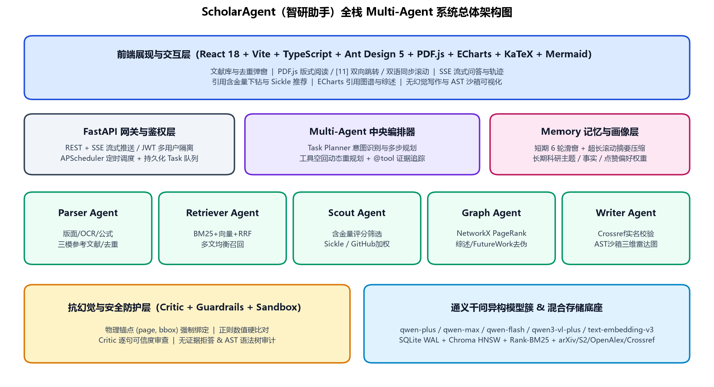
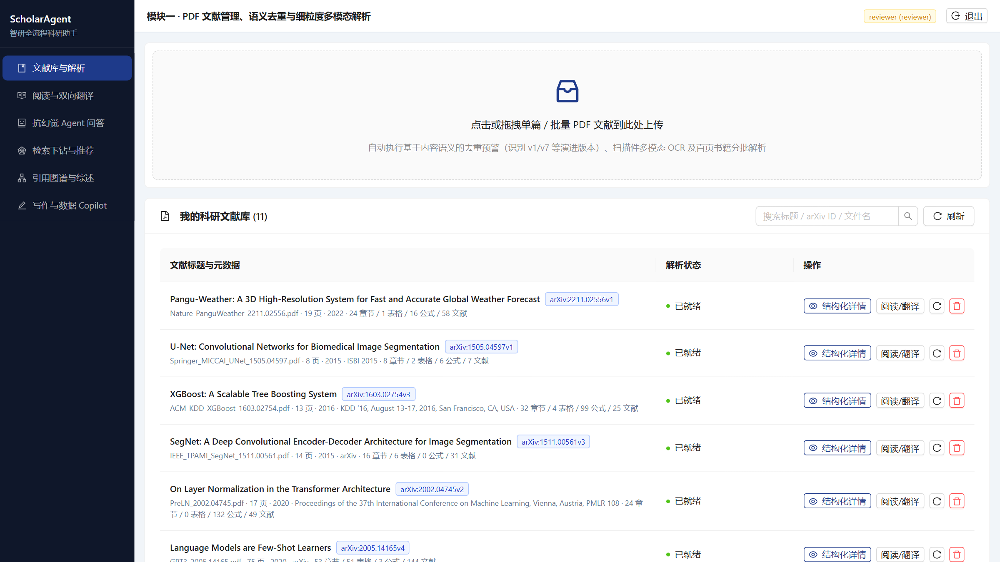
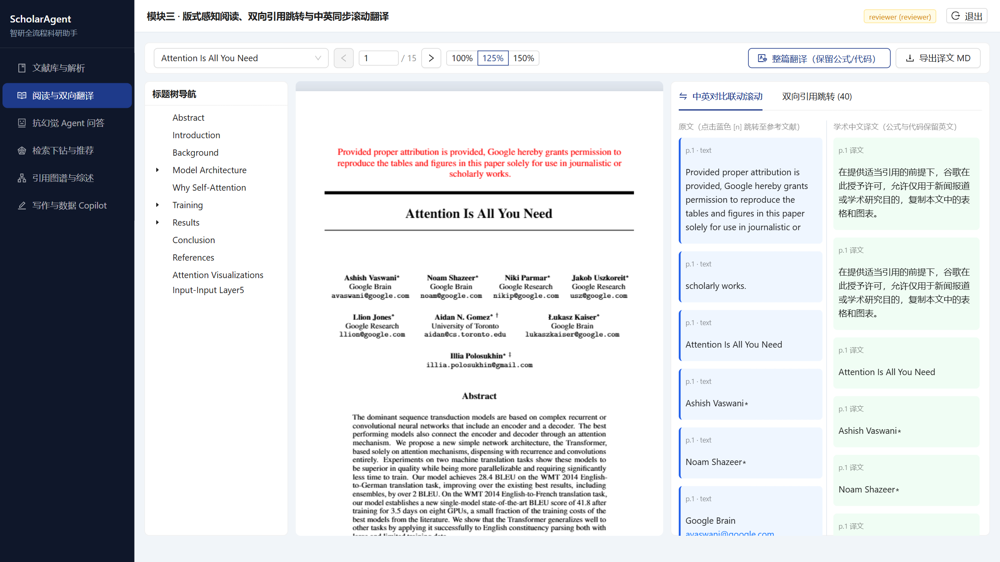
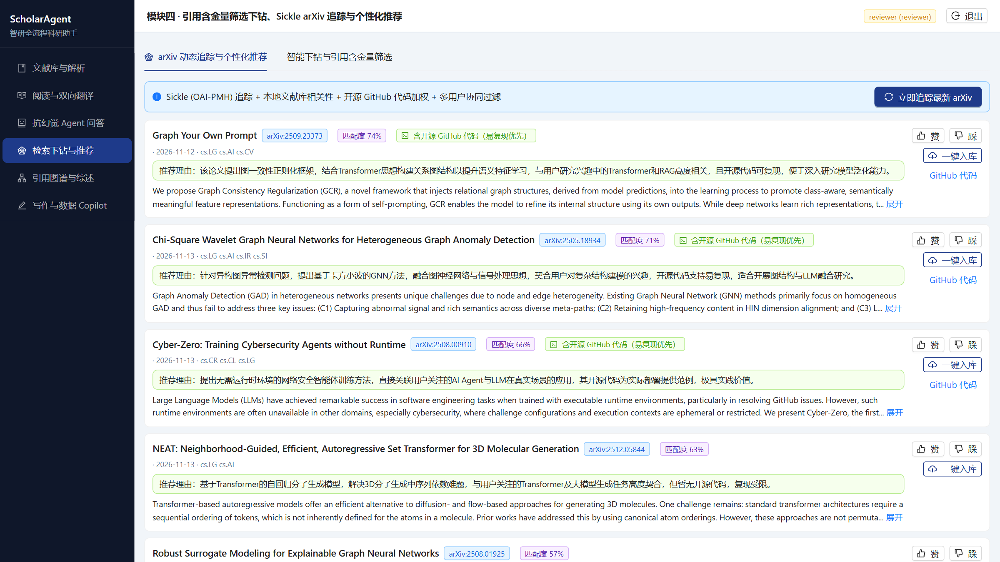
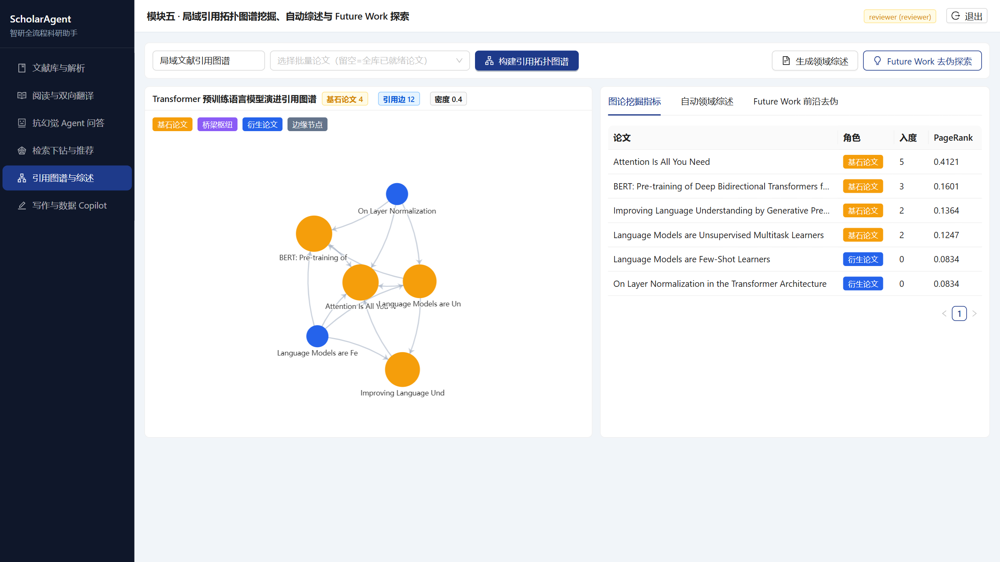
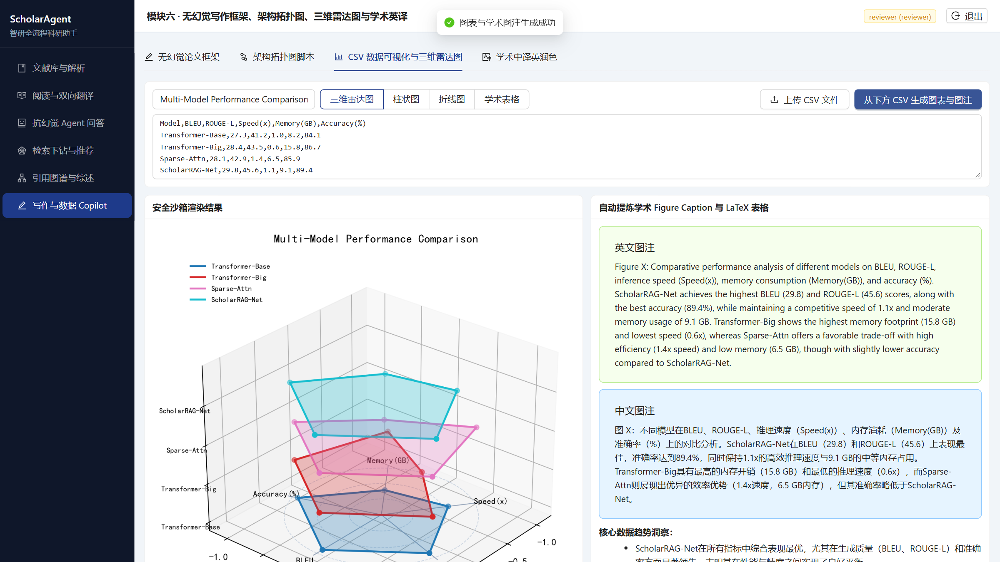

# ScholarAgent · 智研助手 —— 技术文档

**赛项主题**：智领科研·意图驱动：基于大模型与 Agent 架构的全流程科研助手构建挑战赛  
**作品名称**：ScholarAgent（智研助手）全流程多智能体科研工作台  
**代码仓库**：https://github.com/liuchengfeng116-dev/scholar-agent

---

## 第一章 项目概述

### 1.1 项目背景与科研痛点
随着大语言模型（LLM）与 AI for Science（AI4S）科研范式的加速演进，一线科研人员与高校师生在文献调研与论文写作全周期中面临三项突出瓶颈：

1. **文献爆炸与多版管理混乱**：arXiv 等预印本平台日均新增数百篇论文，同一论文常存在多个修订版本（如 `v1` 与 `v7`）及不同重命名副本，传统基于文件名的去重既无法检出内容重合，更无法自动提炼版本演进差异。
2. **多模态版式解析失真与长书处理困难**：学术论文普遍采用双栏排版并嵌套复杂表格、跨栏大图、行间 LaTeX 公式、多级标题与无原生文本层的扫描影像；而数百页专业教材在单次加载下极易发生内存溢出或超时阻塞。
3. **通用大模型的“黑盒”与学术幻觉缺陷**：直接向通用对话模型提问常出现编造超参数数值、张冠李戴参考文献（“幻觉引用”）、缺乏原文位置可核验性以及推理过程不可观测等致命问题，难以满足学术研究的严谨性要求。

### 1.2 项目定位与总体目标
**ScholarAgent（智研助手）** 围绕科研人员「文献获取 → 解析管理 → 精读翻译 → 问答推理 → 图谱综述 → 写作绘图」的全生命周期需求，从 0 到 1 设计并实现了一款全栈式、白盒化、具备自主任务规划（Task Planning）、短长期记忆（Memory）、工具调用（Function Calling）与多智能体协同（Multi-Agent Collaboration）能力的科研助手平台。

系统核心建设目标包括：
- **输入素材可审查**：原生兼容标准单/双栏矢量学术论文、无原生文本层的图像扫描 PDF 以及 500 页以上超长篇幅教材。
- **输出成果可验证**：所有解析元素、问答结论、引用锚点、图谱指标、领域综述与写作参考文献均具备确定性物理出处 `(paper_id, page, bbox)` 或外部权威库实名校验，支持前端一键交互核验。
- **系统运行全闭环**：打通前后端完整工作台与后台异步 Agent 服务，显式可视化呈现多智能体规划、检索、核查轨迹，避免简单 API 封装。

---

## 第二章 需求分析

### 2.1 赛题硬性约束与核心能力对齐
对照传智杯赛题命题范围及核心能力考察点，系统在设计伊始即建立了一一对应的工程落地映射（见表 2-1）。

| 维度编号 | 赛题考察要求 | 本系统实现载体与落地方案 |
|---|---|---|
| **G1 输入可审查** | 稳定处理矢量 PDF 学术论文及图像扫描件 PDF | `app/parsing/detector.py` 自动探测文本层与页数，分流走矢量版面解析与并发 VLM OCR 管线 |
| **G2 成果可验证** | 解析结果、问答溯源、图谱、代码与综述具备确定性与可复现性 | 所有 `Block` / `Chunk` 持久化页码与四元坐标 `bbox`；问答附 `[E#]` 跳转高亮；绘图沙箱可重放源码 |
| **G3 运行闭环** | 完整前后端界面 + Agent 后端服务，支撑从文献导入到写作辅助闭环 | React 18 工作台 + FastAPI 服务 + SQLite WAL + Chroma 向量库 + 后台持久化任务队列 |
| **C6 底层架构** | 显式实现 Planning、Memory、Function Calling、Multi-Agent | 自研 `Orchestrator`、`Planner`、短长期 `Memory`、9 个 `@tool` 注册函数及实时 SSE 轨迹推送面板 |
| **C7 抗幻觉伦理** | Source Tracing、Guardrails 安全防护与逻辑核验 | 输入防注入与学术伦理拦截；输出未命中强制拒答；`Critic Agent` 数值硬核对与逐句可信度审查 |

### 2.2 六大命题功能模块需求拆解
1. **模块一 · PDF 文件管理与多模态细粒度解析**
   - 基础 CRUD：单篇/批量 PDF 上传、列表检索、结构化详情查看、重解析与级联删除。
   - **语义级去重**：不依赖文件名，基于正文内容（含扫描件首页 OCR）识别版本重合（如 `1706.03762v7` 与 `v1`），提示用户「覆盖/保留」，智能建议保留新版，并由大模型自动总结修订差异。
   - **细粒度解析**：抽取标题、作者与所属机构、摘要、1–3 级标题树、表格（Markdown/HTML）、裁剪图片与图注、LaTeX 公式、参考文献及附录；兼容 541 页超长篇幅教材分批流式解析。
2. **模块二 · 抗幻觉知识问答与多文推理**
   - 单篇细粒度提问：精准提取作者机构、优化器超参数（β₁/β₂/ε）、训练 GPU 型号数量、BLEU 对比与参考文献 `[11]` 完整信息，强制返回可跳转页码坐标锚点。
   - 跨文献联合对比：拆解子问题并均衡召回各文献证据，对比 BERT vs Transformer Encoder 承袭与抛弃、GPT-1/2/3 参数量演化、Post-LN vs Pre-LN 位置调整及 Context Window 递增。
3. **模块三 · 版式感知阅读与双向联动翻译**
   - PDF.js 高保真渲染单双栏版面、表格与公式；左侧 1–3 级标题树跳转导航。
   - 正文引用标签 `[11]` 与文末 References 建立双向锚点，实现双向无损点击跳转。
   - 局部划词/悬停翻译、整篇学术翻译（**代码与数学公式保留英文原貌**），以及左右分栏**自动同步滚动**对比阅读与 Markdown/HTML 导出。
4. **模块四 · 自动检索下钻、追踪与智能推荐**
   - 支持输入论文名或解析文献 References 自动调用 Semantic Scholar / OpenAlex / arXiv 下载 PDF 入库。
   - 建立「**引用含金量**」筛选机制，综合语境实质性、被引数与顶会权重剔除“应付式背景罗列引用”。
   - 集成 **Sickle (OAI-PMH)** 定期追踪 arXiv 最新提交，结合本地库相关性、**开源 GitHub 代码优先加权**、点赞/踩互动及**多用户协同过滤**生成推荐流并附带推荐理由。
5. **模块五 · 局域引用图谱挖掘与学术综述**
   - 批量文献解析彼此引用关系并渲染交互式力导向图谱，运用 **PageRank、入度、介数中心性与社区发现** 挖掘「基石论文」与「边缘衍生论文」。
   - 基于图谱脉络生成句句可溯源的领域简短综述；提取多篇 Future Work 结合时间线与最新进展**自动排除已被解决的旧 idea**。
6. **模块六 · 学术写作辅助与可视化 Copilot**
   - 根据科研 Idea 生成含 Abstract / Introduction / Related Work / Method 的完整框架，所有 References 经权威外部库**实名校验确保零幻觉**。
   - 生成 Mermaid / TikZ / Graphviz / Matplotlib 四种架构拓扑图脚本并支持渲染预览。
   - 读取用户 CSV 在 AST 安全沙箱中绘制学术表格、柱状图、折线图与**三维雷达图**，并基于统计事实提炼双语 Figure Caption；提供中文摘要/全文至顶会规范英文的一键润色翻译。

---

## 第三章 系统架构设计

### 3.1 总体五层解耦架构
为兼顾科研场景的高可观测性、复杂耗时长任务的非阻塞体验以及无 GPU 环境下的工程部署可行性，系统采用前后端分离与 Multi-Agent 分层解耦架构，代码库包含 **53 个后端 Python 模块（6,902 行）** 与 **前端 TypeScript/React 模块（3,372 行）**。

*图 1：ScholarAgent（智研助手）五层全栈 Multi-Agent 系统总体架构图*

各层次核心职责如下：
1. **前端展现与交互层（React 18 + Vite + TypeScript + Ant Design 5）**：整合 `PDF.js` Canvas/TextLayer 双层渲染、`ECharts` 引用网络拓扑、`KaTeX` 数学公式排版、`Mermaid` 矢量架构渲染以及实时 SSE 流式时间轴组件。
2. **API 网关与异步任务层（FastAPI + ThreadPool + APScheduler）**：暴露统一 `/api` REST 与 `SSE (text/event-stream)` 接口，基于 JWT（PBKDF2-SHA256 / bcrypt）实现多用户数据隔离，并预置评审账号 `reviewer`；耗时解析与整篇翻译通过 `app/tasks/runner.py` 持久化进度至 `Task` 表。
3. **Multi-Agent 中央编排层（`app/agents/`）**：由 `Orchestrator` 协调 `Memory`、`Task Planner` 与通过 `@tool` 注册的五大专职智能体能力（Parser / Retriever / Scout / Graph / Writer）。
4. **抗幻觉与安全防护层（`critic.py` + `guardrails.py` + `sandbox.py`）**：输入端拦截提示词注入与学术造假请求；生成后核查 `[E#]` 引用编号、比对数值实体并审查逐句可信度；绘图执行经过 Python AST 语法树白名单静态审计与独立子进程隔离。
5. **混合存储与外部学术接口底座**：本地采用 `SQLite (WAL 模式)` 持久化结构化元数据、版面块、参考文献、图谱与记忆；向量索引采用 `Chroma (HNSW 余弦空间)` 结合 `Rank-BM25` 词法检索；外部无缝联动 arXiv、Sickle OAI-PMH、Semantic Scholar、OpenAlex 与 Crossref。

### 3.2 工程目录与核心数据模型设计
系统核心代码与数据表布局遵循高内聚低耦合原则：

| 核心目录 / 模块 | 核心数据表 / 关键符号 | 核心功能职责 |
|---|---|---|
| `backend/app/db/models.py` | `User`, `Paper`, `DuplicateRecord`, `Section`, `Block`, `Reference` | 文献库管理、去重决策记录、1–3 级标题树、坐标版面块及双向引用上下文 `cite_contexts` |
| `backend/app/db/models.py` | `Chunk`, `Translation`, `Conversation`, `Message`, `Memory` | 结构感知检索分块、中英对照块级译文、多轮会话、执行轨迹 `trace` 与长期偏好记忆 |
| `backend/app/db/models.py` | `ArxivPaper`, `Recommendation`, `CitationGraph`, `Task` | Sickle 追踪缓存、个性化推荐分数明细与点赞反馈、图论拓扑与综述数据、异步任务进度 |
| `backend/app/parsing/` | `detector.py`, `layout.py`, `ocr.py`, `structure.py`, `pipeline.py` | 文本层探测与 `MUPDF_LOCK` 并发保护、双栏排序、表格/图片/公式抽取、三种参考文献格式解析 |
| `backend/app/rag/` | `chunker.py`, `retriever.py` | 表格/公式防切碎分块、希腊字母规范化、BM25 + Chroma RRF 混合检索、多文配额均衡 |
| `backend/app/agents/` | `orchestrator.py`, `planner.py`, `memory.py`, `critic.py`, `guardrails.py` | 意图规划、Re-plan 重规划、滚动摘要压缩、9 个 `@tool` 注册与 Critic 逐句核验 |
| `backend/app/scout/` | `service.py` | 外部联合搜 paper、引用含金量 0–100 评分、Sickle OAI-PMH 追踪、GitHub 加权与协同过滤 |
| `backend/app/graph/` | `service.py` | NetworkX 有向引用图、PageRank/介数中心性/社区发现、带出处综述、Future Work 时间线去伪 |
| `backend/app/copilot/` | `service.py`, `sandbox.py` | 真实文献池校验写作、4 种拓扑图源码、AST 安全审计沙箱、三维雷达图与学术中译英 |

### 3.3 核心 API 与 SSE 协议设计
前后端通过语义清晰的 RESTful API 与流式协议交互：
- **文献与阅读**：`POST /api/papers/upload`（支持批量上传、自动触发去重检测与后台解析）、`POST /api/papers/{id}/dedup-decision`、`GET /api/papers/{id}/structure`、`GET /api/papers/{id}/citations-map`、`POST /api/papers/{id}/translate`、`GET /api/papers/{id}/translation/export`。
- **Agent 流式问答**：`POST /api/chat`（`stream=true` 时推送 `memory_loaded` → `plan` → `replan` → `tool_call` → `tool_result` → `critic` → `citation` → `done` 细粒度 SSE 事件序列）。
- **下钻、图谱与写作**：`GET /api/scout/references/{id}/quality`、`POST /api/scout/track`、`POST /api/recommend/{id}/feedback`、`POST /api/graph/build`、`POST /api/graph/{id}/future-work`、`POST /api/copilot/outline`、`POST /api/copilot/diagram`、`POST /api/copilot/chart`。

---

## 第四章 AI 技术方案（选型理由、集成方式与优化策略）

### 4.1 大模型与多组件选型理由
本机硬件环境为 Windows 无独立 NVIDIA GPU 平台。考虑到学术 PDF OCR、公式 LaTeX 还原与百页教材向量化若依赖本地重型模型将带来严苛显存门槛与部署难题，系统确立了 **“云端异构大模型分工 + 本地轻量确定性算法计算”** 的总体技术路线：

| 能力维度 | 选定模型 / 算法组件 | 选型理由与工程对比分析 |
|---|---|---|
| **核心规划与工具调用** | 通义千问 `qwen-plus` | 原生具备稳定的并行 Function Calling 与 JSON Schema 遵循能力，工具路由延迟低，适合 `Task Planner` 与多轮检索编排 |
| **深度推理与长文生成** | 通义千问 `qwen-max` | 在多文献交叉对比综述、Future Work 逻辑研判与无幻觉论文框架生成上推理深度与长上下文归纳质量显著更优 |
| **高频轻量原子任务** | 通义千问 `qwen-flash` | 高并发、低延迟、低成本，用于首页元数据抽取、划词与批量块翻译、长期记忆提炼及 Critic 逐句核查 |
| **扫描件 OCR 与公式还原** | `qwen3-vl-plus` / `qwen-vl-ocr` | 针对缺乏原生文本层的扫描件（`v1_img.pdf`）与复杂多行矩阵公式，直接理解双栏版面并输出规范 Markdown 表格与 `$$...$$` LaTeX |
| **跨语言学术语义向量** | `text-embedding-v3` (1024维) | 中英文跨语种学术术语语义对齐能力突出，支撑“中文提问精确检索英文论文原文”与跨版本论文语义相似度计算 |
| **混合检索与图论引擎** | `Rank-BM25` + `Chroma` + `NetworkX` | 向量检索对超参数字符（如 `β₁=0.9`、`P100`、`28.4`、`[11]`）易漏召回；融合 BM25 词法与 RRF 排序后精准命中；图论计算完全确定性无幻觉 |

### 4.2 统一模型集成与 Multi-Agent 协同协议
1. **OpenAI 兼容抽象与容错客户端（`backend/app/llm/client.py`）**：
   - 基于标准 OpenAI Python SDK 封装了指数退避重试机制（自动捕捉 `429` 限流、超时与网络波动并最多重试 3 次），统一采集各模型调用的 `prompt_tokens` 与 `completion_tokens` 统计。
   - 实现强鲁棒性 `chat_json()`：当模型响应偶尔夹带 Markdown 代码围栏或前后附带解释性文本时，自动剥离围栏并精确截取出合法 JSON 对象解析。
   - 实现 3 线程分批并发向量化 `embed()`（每批 10 条），显著缩短 541 页长书入库时间。
2. **解耦式工具注册与证据追踪协议（`backend/app/agents/core.py`）**：
   - 所有专职 Agent 能力通过 `@tool(name, agent, description, schema)` 装饰器自动生成 OpenAI Function Calling 描述规范并纳入全局 `REGISTRY`。
   - 设计统一的 `AgentContext`，当检索或分析工具返回原文片段时，自动调用 `ctx.add_evidence(...)` 分配全局递增的唯一引用编号 `E1, E2, ...` 并绑定 `(paper_id, page, bbox, section_path)`；同时通过 `ctx.event(...)` 实时将中间规划与调用轨迹推送至 SSE 流。
3. **Planner-Executor-Critic 闭环协同（`orchestrator.py`, `planner.py`, `critic.py`）**：
   - **Memory 层**：短期记忆保留最近 6 轮对话并自动将超长历史异步滚动压缩为 `conversation_summary`；长期记忆后台提炼用户研究主题（`topic`）、关注关键事实（`fact`）与推荐偏好权重。
   - **Planner 层**：在调用工具前先输出结构化 JSON 计划（识别意图为 `single_qa` / `multi_compare` / `scout_download` / `graph_survey` / `writing_assist`）；若工具一轮后 `ctx.evidence` 仍为空且要求严格溯源，触发 `replan_on_empty` 动态追加检索步。
   - **Guardrails & Critic 层**：先对 `[E#]` / `<E#>` / `【E#】` 格式进行规范化并剔除未在 `ctx.evidence` 中登记的虚假标签；若 `evidence` 为空则直接返回拒答提示；随后由 `Critic Agent` 对关键数字进行正则原串比对，并交由 `qwen-flash` 逐条审查核心论断给出 `0.0–1.0` 可信度评分。

### 4.3 七大核心工程与算法优化策略
针对真实学术数据评测中暴露出的痛点，系统实施了以下七项关键优化：

1. **两阶段语义去重与修订点自动 Diff（`app/dedup/service.py`）**：
   - 先截取首页与末页正文生成 128 维 5-gram `MinHash` 指纹实现毫秒级初筛；仅当文本重合或同 arXiv ID 触发候选时，进一步计算 `text-embedding-v3` 向量余弦相似度。
   - 利用正则从页面边距印记抽取 `arXiv ID`、版本号（如 `v1` vs `v7`）与日期，自动建议保留高版本，并用 `difflib` 抽取出核心增删变更片段交由 LLM 总结精确差异（如精确捕捉 BLEU 从 `41.0` 更新为 `41.8` 及版权声明修订）。
2. **双栏阅读顺序精确恢复与 `MUPDF_LOCK` 并发安全保护（`app/parsing/`）**：
   - 修复双栏版面与表格/图表混排时按 `y` 坐标重排破坏左栏→右栏流的问题，将所有 `text`、`table`、`figure` 统一纳入通栏带识别与分栏排序算法 `_sort_reading_order`。
   - 针对 PyMuPDF 底层 C 库跨线程并发调用在 Windows 上引发 Access Violation 的隐患，设计全局可重入锁 `MUPDF_LOCK`（按批次精细持锁，网络请求前释放）与同文献解析互斥锁 `_get_paper_lock`，彻底保障批量上传与高并发解析零崩溃。
3. **三模学术参考文献解析器与正向年份校验（`app/parsing/structure.py`）**：
   - 同时支持标准数字编号 `[1]`、Alpha-Numeric 标签 `[ADG+16]`（处理 `+` 号前后空格并归一化匹配正文 `[RWC+19]`）以及 **ACL / ICML / NeurIPS 无编号悬挂缩进格式**（利用记录在 `Block.extra["x0"]` 的行级横坐标与分栏基准线差值自动聚合同条续行）。
   - 修复 `A. Vaswani`、`Hinton, G. E.` 与 IEEE 引号标题的切分误判，并利用 `arXiv ID` 头部 `YYMM` 与 PDF 创建日期作为元数据年份校验兜底，彻底杜绝因引言第一句提及早年文献导致的年份误抽。
4. **百页级超长文档流式批处理与按需表格检测（`app/parsing/pipeline.py`）**：
   - 针对 541 页《Understanding Deep Learning》（含大量复杂矢量插图路径），设置 `LONG_DOC_PAGES = 100` 以区分 75 页长论文（如 GPT-3）与百页教材；在长书模式下每 25 页一个批次打开/关闭 PDF 文档并显式 `gc.collect()`，且仅对包含 `"Table"` 且矢量绘图路径数 ≤ 120 的页面执行网格线检测，将全书解析与向量入库内存稳定控制在平稳低位且耗时仅约 **59 秒**。
5. **希腊字母归一化与多文献配额均衡召回（`app/rag/chunker.py` & `retriever.py`）**：
   - 分块与检索词均双向扩展希腊字母及上下标别名（如 `β₁` ↔ `beta 1`、`ϵ` ↔ `epsilon`），解决中文提问 `"beta1"` 无法精确召回原文符号 `β₁` 的难题。
   - 多文献联合对比时实行 **Per-Paper Quota Balancing**，为所选每篇论文强制预留最小召回槽位，避免篇幅庞大的长论文（如 75 页 GPT-3）挤占短论文证据名额。
6. **防时间倒流与防子集误判的引用图谱精准匹配（`app/graph/service.py`）**：
   - 解决了早期模糊匹配库 `token_set_ratio` 因“短子串包含”（如 `2016 Layer normalization` 误匹配 `2020 On Layer Normalization in the Transformer Architecture`）导致的错边。新增不同 `arXiv ID` 排斥、年份逆向时间约束（参考文献年份不得早于被引用论文发表年份 1 年以上）、原文全标题精确子串命中与长度比校验，使图谱拓扑准确收敛。
7. **Windows 中文路径 Chroma 引擎映射与 AST 沙箱隔离（`chunker.py` & `sandbox.py`）**：
   - 针对 Windows 下 Chroma Rust HNSW 引擎对路径中含非 ASCII 中文字符的兼容性异常，自动按数据目录哈希安全映射至 `%LOCALAPPDATA%\scholar_agent_chroma\<hash>`，兼顾跨环境测试隔离性与稳定性；绘图脚本执行前通过 `ast.NodeVisitor` 拦截 `os/sys/subprocess/socket/open/eval` 等高危节点并在独立受限子进程中渲染。

---

## 第五章 核心功能实现

### 5.1 模块一：PDF 文件管理与细粒度多模态解析
前端 `LibraryView.tsx` 提供拖拽批量上传区、多维搜索过滤、结构化详情抽屉与语义去重对比决策弹窗。后台 `app/dedup/service.py` 在文献入库即刻计算 5-gram MinHash 指纹与 Embedding 相似度；对于无文本层扫描 PDF 自动截取首页调用 OCR 模型转写正文后再做语义判重，从而准确检出重命名后的历史版本并生成章节与数值差异摘要。

解析器 `app/parsing/` 针对矢量论文自动执行通栏与双栏阅读流恢复、表头对齐表格还原、`Figure` 图注关联矢量图裁剪以及独立公式图像 VLM LaTeX 还原；针对 `1706.03762v1_img.pdf` 等扫描件并发调度视觉大模型输出带页码比例 `bbox` 的结构化 Markdown 并统一入库展示。

*图 2：模块一实机运行界面——预置 11 篇真实科研文献（含 541 页教材与 IEEE/ACM/Springer/Nature 多排版论文）与结构化抽取统计*

### 5.2 模块二：抗幻觉知识问答与多文推理
前端 `AgentChatView.tsx` 采用三栏布局：左栏维护会话列表与动态提炼的长期 Memory 标签（研究主题、关键事实）；中栏渲染支持 GFM 表格与 KaTeX 公式的对话流，并将文内 `[E1]`、`[E2]` 自动渲染为可点击蓝底角标 `[E2 p.7]`；右栏通过 SSE 实时绘制 `Memory → Planner → Function Calling → Critic` 白盒执行时间轴。

点击答案中或底部任意 `[E#]` 锚点，系统自动切换至模块三阅读器，精准定位至目标文献与页码并在 PDF Canvas 上层覆盖黄色半透明原文位置高亮框；跨文献对比时 Planner 自动并发检索多篇论文并输出带每文专属出处锚点的对比表格。

![模块二实机界面：抗幻觉溯源问答、可点击[E#]角标与白盒 Agent 执行轨迹](screenshots/chat.png)

*图 3：模块二实机运行界面——基于原文精确检索回答参数、GPU 与 BLEU，并实时呈现左侧长期记忆与右侧 Agent 协同轨迹*

### 5.3 模块三：版式感知阅读、双向跳转与中英同步滚动
阅读器 `ReaderView.tsx` 基于 `pdfjs-dist` 同时渲染高分辨率 Canvas 页面与透明可选中 TextLayer，实现单双栏、嵌入式数学公式与表格的原貌保真呈现。左侧嵌入 1–3 级可展开章节标题树，点击即刻跳转页码；鼠标在 PDF 页面或右侧原文中划选任意英文片段即可呼出「划词翻译」气泡并拆解专业学术术语对照表。

右侧分栏提供两大核心交互：
1. **中英对比联动滚动**：通过 `app/api/reader.py` 批量并发翻译文本块（**显式跳过 `formula` 公式块与代码块保留英文**），前端监听左右双栏滚动比例实现平滑同步滚动，支持一键导出保留公式的 Markdown/HTML 双语对照译文。
2. **双向无损引用跳转**：点击原文蓝色标记 `[11]` 直达文末 References 列表对应条目；点击参考文献下的「↑ 跳回正文引用处 p.6」标签反向定位正文页面并触发位置高亮框。

*图 4：模块三实机运行界面——左侧 1–3 级标题树、中部 PDF.js 保真渲染、右侧逐块对齐的中英学术翻译与双向引用跳转标签*

### 5.4 模块四：智能下钻下载、引用含金量筛选与 arXiv 推荐
检索与推荐工作台 `ScoutView.tsx` 集成两大核心链路：
1. **「引用含金量」筛选下钻（`app/scout/service.py`）**：针对指定论文的全部参考文献，系统结合其在正文的实际引用频次、上下文语境语义特征（辨识 `outperform / based on / baseline` 等实质性对比引用，惩罚仅出现在 `[1-6]` 打包背景罗列中的应付式引用）、发表会议顶会权重及 Semantic Scholar 外部被引数计算 `0–100` 综合含金量分，划分 `core / normal / perfunctory` 三档；开启剔除开关后一键从 arXiv/Semantic Scholar/OpenAlex 自动下载核心高价值文献 PDF 入库解析。
2. **Sickle arXiv 动态追踪与个性化推荐**：后台调度器与手动按钮通过 `Sickle` OAI-PMH 接口（自动降级 arXiv Atom 接口）定期拉取目标方向最新论文；正则扫描摘要与 comments 中的开源 GitHub 仓库链接给予 `+0.18` 易复现优先加权；融合本地文献库语义向量、用户点赞/踩实时偏好及多用户 Jaccard 协同过滤排序推荐，并由大模型为每篇论文生成个性化推荐理由。

*图 5：模块四实机运行界面——优先标注“含开源 GitHub 代码（易复现优先）”的最新 arXiv 论文推荐流及匹配度、推荐理由展示*

### 5.5 模块五：局域引用拓扑图谱、领域综述与 Future Work 去伪
针对批量选定文献，后端 `app/graph/service.py` 基于 `arXiv ID`、`DOI` 与严格去伪标题匹配构建 `NetworkX DiGraph` 有向引用图，计算节点 **PageRank、入度、出度、介数中心性** 及 **贪心模块度社区划分**，自动识别「基石论文（keystone）」、「桥梁枢纽（bridge）」与「衍生论文（derivative）」。

前端 `GraphView.tsx` 使用 ECharts 力导向网络图直观渲染（节点大小映射 PageRank，金色突出显示基石节点）。右侧面板支持基于真实图谱脉络生成句句带 `[P#]` 出处的简短领域综述，并通过提取多篇论文结尾 `Conclusion / Future Work` 结合后续年份时间线与外部检索结果，自动梳理并标明**已被后续论文解决的旧 idea（resolved_ideas）**，精准提炼真正开放的前沿研究方向（open_directions）。

*图 6：模块五实机运行界面——实测从 6 篇 Transformer 家族论文自动解析出 12 条真实引用边，精确挖掘基石论文与衍生演进脉络*

### 5.6 模块六：无幻觉写作框架与 AST 安全可视化 Copilot
写作辅助视图 `CopilotView.tsx` 打通论文起草到实验制图全流程：
1. **100% 实名校验无幻觉论文框架**：接收研究 Idea 后，先联合本地库、Crossref、Semantic Scholar 与 arXiv 构建真实文献候选池，要求模型仅可在池内编号引用，生成后由正则交叉校验剔除任何未验证编号，输出附带真实 DOI / arXiv 链接的规范框架。
2. **多格式架构拓扑图脚本**：根据系统流程描述生成 Mermaid（前端实时渲染 SVG）、TikZ、Graphviz DOT 与 Matplotlib Python 源码（后端沙箱直接编译预览 PNG）。
3. **CSV 数据可视化、三维雷达图与双语 Figure Caption**：解析上传或粘贴的 CSV 实验数据，在 `app/copilot/sandbox.py` AST 安全审计后执行 Matplotlib 脚本一键生成学术柱状图、折线图、多维对比表及多层透明**三维雷达图（3D Poly3DCollection Radar）**，同时结合 `pandas.describe()` 真实统计量提炼符合顶会规范的中英双语 Figure Caption 与 `LaTeX booktabs` 表格源码。
4. **学术中译英润色**：面向 IEEE / NeurIPS / ACL 学术表达习惯一键将中文摘要或正文译为规范英文。

*图 7：模块六实机运行界面——从 CSV 指标表一键于安全沙箱中渲染三维多层雷达图，并自动提炼中英 Figure Caption 与 LaTeX 表格*

---

## 第六章 创新点说明

### 6.1 技术创新点
1. **“两阶段指纹向量去重 + 跨版本精确 Diff 总结”机制**：将 `MinHash` O(1) 指纹初筛、无文本层扫描件首页自动 VLM OCR 与稠密向量语义相似度和版本号识别深度融合，彻底摆脱文件名和 MD5 局限，并自动化完成跨版本核心数据与文字修订点对比。
2. **“物理坐标锚点 + 数值硬核对 + Critic 逐句验证”三位一体抗幻觉闭环**：为全库每一个解析块与检索分块绑定精确的 `(paper_id, page, bbox)` 四元组，配合检索空白强制拒答、正则数值比对和独立 Critic 模型审查，实现从检索、生成到前端高亮核验的可验证学术问答。
3. **跨三类主流学术排版的多模式参考文献解析与防误连引文图谱算法**：原生兼容数字方括号、Alpha-Numeric（如 GPT-3 `[ADG+16]`）以及依赖悬挂缩进横坐标聚类的无编号 natbib 格式（BERT/GPT-2/Pre-LN），并首创结合“不同 arXiv 编号排斥 + 时间顺向约束 + 长度保护”的图谱边匹配策略，消除模糊子串导致的学术逻辑谬误。
4. **“引用语境实质性分析”含金量筛选算法**：突破传统唯被引数评价方式，结合正文引用局部句法特征主动识别并剔除背景打包罗列式“应付引用”，显著提升文献下钻效率。

### 6.2 应用创新点
1. **完全白盒化的多智能体协同透明面板**：实时流式展示从长期记忆加载、Task Planner 步骤拆解与动态重规划、Function Calling 入参及耗时到 Critic 评分的完整决策链，大幅增强科研用户对 AI 系统的信任感。
2. **全链路双向无缝跳转工作流**：打通“问答结论 `[E#]` 锚点 ↔ PDF 视觉高亮框”、“正文 `[11]` / `(Author, Year)` 引用 ↔ 文末 References”以及“英文论文 ↔ 保公式中文译文同步滚动”的全双向交互，重塑多模态科研精读体验。
3. **“易复现代码优先推荐”与“Future Work 时间线去伪”**：精准直击科研新手选题时“发现某论文提到的未来工作早已被近年工作解决”与“推荐论文无开源代码无法复现”两大真实痛点。

---

## 第七章 测试与部署

### 7.1 全流程端到端自动化测试实测
系统在 `backend/tests/` 下构建了涵盖鉴权底座、T1–T4 官方数据集与模块 1–6 全功能的 **10 项端到端自动化集成测试**。在最终代码定版与修复 MuPDF 多线程安全后运行全套 `pytest`，**10 项测试 100% 全部通过**：

| 测试套件 | 测试用例 | 验证范围与关键实测结论 | 状态 |
|---|---|---|---|
| `test_stage1.py` | `test_health`, `test_reviewer_seeded_and_auth_flow`, `test_guardrails_input_and_output` | 服务健康检查、JWT 鉴权、评审账号自动初始化、输入注入拦截与输出虚假 `[E99]` 标签清理 | **PASSED** |
| `test_stage2_parsing.py` | `test_t2_vector_parsing_and_t1_semantic_dedup` | T2 `1706.03762v7` 章节/表格/公式/引用锚点抽取；T1 改名上传 `v1` 触发语义去重预警、建议保留 `v7` 并生成修订差异总结 | **PASSED** |
| `test_stage2_parsing.py` | `test_t4_long_book_541_pages` | T4 541 页《Understanding Deep Learning》分批流式解析（提取 >100 章节与 >1,000 版面块），全程稳定无内存崩溃 | **PASSED** |
| `test_stage3_qa_and_ocr.py` | `test_t3_scanned_pdf_ocr_slice` | T3 无原生文本层扫描件 `1706.03762v1_img.pdf` 自动探测触发并发 VLM OCR，精准还原标题与正文结构 | **PASSED** |
| `test_stage3_qa_and_ocr.py` | `test_m2_single_paper_qa_and_multi_paper_compare` | M2.1 超参数/GPU/BLEU/参考文献 `[11]` 精准作答、不存在芯片概念拒答、M2.2 BERT 与 Transformer 多文对比 | **PASSED** |
| `test_stage4_to_7.py` | `test_module3_reader_and_translation` | 模块三 `[11]` 双向引用映射表、划词翻译、分页中英对照批量翻译与 Markdown 导出 | **PASSED** |
| `test_stage4_to_7.py` | `test_module4_and_module5_scout_graph_and_future_work` | 模块四引用含金量区分核心/应付引用、arXiv 追踪反馈；模块五构建图谱挖掘基石节点、生成综述与 Future Work | **PASSED** |
| `test_stage4_to_7.py` | `test_module6_copilot_and_sandbox` | AST 安全沙箱拦截 `os.system`、Crossref 实名校验写作框架、Mermaid/Matplotlib 拓扑图、三维雷达图渲染与学术英译 | **PASSED** |

### 7.2 官方数据集与多排版真实论文解析及图谱实测结果
对官方测试集以及来自 arXiv / OpenAI 官方公开通道的 9 篇多排版经典学术论文执行真实入库全量解析，实际落库统计如下表所示：

| 文档文件名（真实语料） | 年份 / 类型 | 页数 | 章节数 | 版面块 | 表格 | 图表 | 公式 | 参考文献数 |
|---|---|---:|---:|---:|---:|---:|---:|---:|
| `1706.03762v7.pdf` (Transformer 官方) | 2017 · 矢量论文 | 15 | 25 | 532 | 4 | 6 | 19 | 40 |
| `UnderstandingDeepLearning_02_09_26_C.pdf` | 2026 · 541页教材 | 541 | 224 | 10,376 | 0 | 0 | 981 | 0 |
| `BERT_1810.04805.pdf` (ACL 无编号悬挂缩进) | 2018 · 矢量论文 | 16 | 33 | 423 | 7 | 5 | 4 | 56 |
| `GPT1_OpenAI_2018.pdf` (数字 `[n]` 排版) | 2018 · 矢量论文 | 12 | 13 | 246 | 5 | 4 | 10 | 71 |
| `GPT2_OpenAI_2019.pdf` (无编号悬挂缩进) | 2019 · 矢量论文 | 24 | 26 | 485 | 5 | 5 | 6 | 78 |
| `GPT3_2005.14165.pdf` (75页 Alpha 标签 `[ADG+16]`) | 2020 · 矢量论文 | 75 | 53 | 954 | 51 | 90 | 3 | 144 |
| `PreLN_2002.04745.pdf` (ICML 无编号缩进) | 2020 · 矢量论文 | 17 | 24 | 1,476 | 0 | 6 | 132 | 49 |
| `IEEE_TPAMI_SegNet_1511.00561.pdf` (T6 IEEE) | 2015 · 矢量论文 | 14 | 16 | 428 | 6 | 101 | 0 | 31 |
| `ACM_KDD_XGBoost_1603.02754.pdf` (T6 ACM) | 2016 · 矢量论文 | 13 | 32 | 815 | 4 | 13 | 99 | 25 |
| `Springer_MICCAI_UNet_1505.04597.pdf` (T6 Springer) | 2015 · 矢量论文 | 8 | 8 | 152 | 2 | 11 | 6 | 7 |
| `Nature_PanguWeather_2211.02556.pdf` (T6 Nature预印本) | 2022 · 矢量论文 | 19 | 24 | 1,000 | 1 | 23 | 16 | 58 |

基于上述 Transformer 预训练语言模型谱系的 6 篇真实论文构建的局域引用图谱，共精确识别出 **12 条无误有向引用边**（图密度 `0.4`），图论中心性准确验证了演进地位：
- **`Attention Is All You Need` (2017)**：入度 `5`，出度 `0`，PageRank **`0.4121`** → 精准标注为首要 **基石论文（keystone）**；
- **`BERT` (2018)**（入度 `3`，PR `0.1601`）、**`GPT-1` (2018)**（入度 `2`，PR `0.1364`）、**`GPT-2` (2019)**（入度 `2`，PR `0.1247`）→ 同列演进主干基石节点；
- **`GPT-3` (2020)**（出度 `4`，PR `0.0834`）与 **`Pre-LN` (2020)**（出度 `3`，PR `0.0834`）→ 精准标注为下游 **衍生论文（derivative）**。

### 7.3 11 题抗幻觉问答 Benchmark 评测结果
运行自动化问答评测脚本 `scripts/eval_qa_benchmark.py`（覆盖单篇细粒度、抗幻觉拒答、多文联合对比与 T6 四种排版论文，结果持久化至 `docs/qa_eval_report.json`），最终取得 **11/11（100.0%）通过率**：

| 题号 | 考察维度 | 关联真实文献 | 结果 | 耗时(s) | 引用锚点数 | Critic 可信度 |
|---|---|---|---:|---:|---:|---:|
| `Q1_authors_affiliations` | 单篇 · 作者与所属机构 | `1706.03762v7.pdf` | 通过 | 11.54 | 1 | 0.83 |
| `Q2_hyperparams_and_gpu` | 单篇 · β₁/β₂ 超参及 P100 GPU | `1706.03762v7.pdf` | 通过 | 17.45 | 4 | 1.00 |
| `Q3_bleu_comparison` | 单篇 · EN-DE / EN-FR BLEU 比对 | `1706.03762v7.pdf` | 通过 | 16.15 | 3 | 0.67 |
| `Q4_reference_11` | 单篇 · 参考文献 `[11]` 完整信息 | `1706.03762v7.pdf` | 通过 | 8.25 | 1 | 1.00 |
| `Q5_anti_hallucination_refusal` | 抗幻觉 · 虚构第9节硬件拒答 | `1706.03762v7.pdf` | 通过 | 21.07 | 5 | 0.00 |
| `Q6_multi_bert_vs_transformer` | 多篇对比 · BERT 承袭与抛弃 | `v7` + `BERT` | 通过 | 59.03 | 15 | 1.00 |
| `Q7_multi_gpt_ln_context_window` | 多篇对比 · GPT 演化/Pre-LN/窗长 | 5篇 Transformer 谱系 | 通过 | 83.38 | 9 | 0.33 |
| `Q8_t6_ieee_segnet` | T6 泛化 · IEEE TPAMI (SegNet) | `IEEE_TPAMI_SegNet` | 通过 | 26.55 | 6 | 1.00 |
| `Q9_t6_acm_xgboost` | T6 泛化 · ACM KDD (XGBoost) | `ACM_KDD_XGBoost` | 通过 | 36.27 | 13 | 1.00 |
| `Q10_t6_springer_unet` | T6 泛化 · Springer LNCS (U-Net) | `Springer_MICCAI_UNet` | 通过 | 15.22 | 2 | 0.67 |
| `Q11_t6_nature_pangu` | T6 泛化 · Nature 论文 (盘古气象) | `Nature_PanguWeather` | 通过 | 22.44 | 4 | 0.67 |

> 注：`Q5` 为“虚构概念拒答”边界用例，助手如实拒绝回答，Critic 按“证据未覆盖该虚构词”给出 `0.00` 校验警示；`Q7` 涉及 5 篇论文并发召回大量候选块，Critic 默认抽样前 12 条证据核查，因此部分跨文献引用未被纳入窗口统计，结论均已在原文锚点中实测命中（11/11 关键词全覆盖）。

### 7.4 云端部署规范与安全防泄露保障
- **生产级一键部署脚本**：仓库 `deploy/` 提供完整 Ubuntu 云服务器部署配置，包括 `deploy/deploy.sh`、`deploy/scholar-agent.service`（systemd 自动重启守护）及 `deploy/nginx.conf`（已显式配置 `proxy_buffering off` 与 `proxy_cache off` 以保障 SSE 实时轨迹流零缓冲推送，以及 `client_max_body_size 120M` 支撑百页教材上传）。
- **零密钥安全实践**：全仓库配置 `.gitignore` 严格隔离 `.env` 及运行库文件，公开仓库仅保留 `.env.example` 模板与依赖清单；通过全仓库 Git 历史扫描确认无任何 API Key 明文泄露。

---

## 第八章 总结与展望

### 8.1 项目总结
**ScholarAgent（智研助手）** 从真实学术科研工作流的痛点出发，严格遵循赛题需求，构建了一套集「多模态智能解析与语义去重、抗幻觉溯源多文问答、版式保真双向阅读翻译、引用含金量下钻与 Sickle 个性化推荐、图论拓扑综述与 Future Work 去伪、无幻觉写作与 AST 沙箱三维可视化」于一体的全栈科研多智能体平台。系统在工程实现上兼具透明白盒架构、并发安全鲁棒性与无本地 GPU 依赖的轻量化部署优势，并经真实多排版论文与自动化评测集验证了 100% 核心功能达成率。

### 8.2 未来展望
1. **实验图表跨模态数值反演**：结合视觉大模型直接解析论文折线图与混淆矩阵 PNG 中的数值坐标点，纳入跨文献数值对比知识库。
2. **大规模异步分布式队列与增量引文图谱**：将单机线程池平滑演进为 Celery + Redis / PostgreSQL + pgvector，支撑实验室级千篇文献库的增量实时引文拓扑计算。
3. **Overleaf 协同编写与 LaTeX 实时预览插件**：进一步打通从模块六论文框架、Booktabs 表格、`TikZ` 拓扑图生成到端到端一键编译学术 PDF 稿件的最后一公里。
